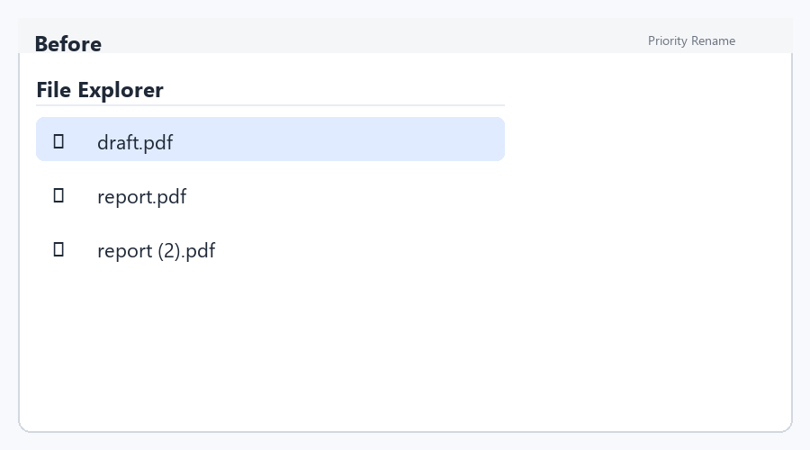

# Priority Rename

Priority Rename is a lightweight Windows background utility for renaming one selected file or folder in File Explorer with the **Ctrl+F2** hotkey.

If the target name already exists, the utility can cascade existing names to make the target name take priority:

- `report.pdf` becomes `report (2).pdf`
- `report (2).pdf` becomes `report (3).pdf`
- The selected item becomes `report.pdf`

## Download

Download the standalone **[PriorityRename.exe](https://github.com/azhan3/priority-rename-windows/releases/latest)** from GitHub Releases. Windows 10/11 users do not need the .NET 8 SDK.

## Demo



## Features

- Global **Ctrl+F2** hotkey
- File Explorer foreground-window detection
- Support for selected files and folders
- System tray menu
- Override / take-priority mode
- Lowest-available-suffix mode
- Locked-file detection
- Rollback-safe staged renames
- In-memory undo for the last rename
- Windows reserved-name and invalid-character validation
- Windows 11 Explorer-compatible COM selection

## Requirements

- Windows 10 or Windows 11
- .NET 8 SDK only when building from source

## Build

```powershell
dotnet build PriorityRename.sln -c Release
dotnet publish PriorityRename/PriorityRename.csproj -c Release -r win-x64 --self-contained true -p:PublishSingleFile=true -o dist
```

The published executable is:

```text
dist/PriorityRename.exe
```

## Run

Start `PriorityRename.exe`. It remains in the system tray.

1. Select exactly one file or folder in File Explorer.
2. Press **Ctrl+F2**.
3. Enter the target name.
4. Press **Enter** to rename or **Escape** to cancel.

Use the tray menu to undo the last completed rename or exit the application.

## Tests

Run the rename engine test harness:

```powershell
dotnet run --project tests/PriorityRename.Tests/PriorityRename.Tests.csproj -c Release
```

## License

This project is released under the [MIT License](LICENSE).
